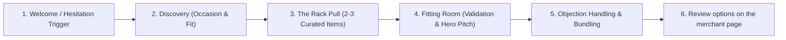

# AI Sales Associate 🛍️🤖

> **Replicating the in-store physical retail salesperson for online e-commerce.**  
> An autonomous, charismatic digital shop-floor stylist that approaches shoppers at the right moment, discovers their needs, provides genuine styling confidence ("Hero" validation), and guides them straight to payment.

---

## 🎯 The Core Problem & Insight

* **Physical Retail Conversion Rate:** **20% – 40%+**
* **Digital E-commerce Conversion Rate:** **2% – 3%**

Why? Online stores are lonely, silent digital warehouses. Customers must guess their size, read dozens of reviews, second-guess themselves, and 97% of the time they abandon their cart.

In a physical boutique, a skilled salesperson:
1. **Welcomes shoppers naturally** without being intrusive.
2. **Discovers the "Why"** when shoppers don't know what to buy (*"Looking for something casual or an upcoming wedding?"*).
3. **Pulls 2–3 curated items off the rack** instead of dumping 50 options.
4. **Delivers the "Hero" moment** (*"Dude, you look like a hero in this shirt"* — killing subconscious self-doubt with styling confidence).
5. **Overcomes objections on the spot** (fit anxiety, fabric care, price doubts).
6. **Walks the customer to the cashier** for a frictionless checkout.

**AI Sales Associate brings this exact human-guided experience to any e-commerce storefront.**

---

## 🛡️ The "Zero-Crash Blast Shield" Architecture

A non-negotiable principle for merchant adoption:
> **Store owners never need to rewrite their tech stack, and the AI Sales Associate can NEVER crash or slow down the host website.**

```
+-------------------------------------------------------------+
|                     Merchant's Website                      |
|           (Shopify, WooCommerce, React, PHP, Webflow)       |
|                                                             |
|   +-----------------------------------------------------+   |
|   |         Single Script Tag (<10KB Loader)            |   |
|   |     <script src=".../loader.js" async defer>        |   |
|   +--------------------------+--------------------------+   |
|                              |                              |
|                              v                              |
|   +-----------------------------------------------------+   |
|   |          Closed Shadow DOM & Error Shield           |   |
|   |  - Isolated CSS (Zero style bleed in or out)        |   |
|   |  - Circuit Breaker (Auto-kills silently on error)   |   |
|   |  - Zero impact on Core Web Vitals (LCP / CLS)       |   |
|   +--------------------------+--------------------------+   |
+------------------------------|------------------------------+
                               | Event Bus & API
                               v
+-------------------------------------------------------------+
|             Cloud AI Sales Engine (LangGraph)               |
|                                                             |
|  [Greeting] -> [Discovery] -> [Curation] -> [Validation]    |
|                                    |                        |
|                                    v                        |
|                             [Objection] -> [Checkout]       |
+-------------------------------------------------------------+
```

### Safety Guarantees
1. **One-Line Install:** Works across Shopify, WooCommerce, Magento, BigCommerce, or custom sites via a single `<script>` tag.
2. **Shadow DOM Sandbox:** UI and CSS styles live in a closed Shadow DOM. It cannot alter or break host site layouts.
3. **Self-Healing Circuit Breaker:** Wrapped in top-level error boundaries. If our backend is unreachable or script throws an exception, it unmounts silently into thin air—leaving the host store running 100% normally.
4. **Zero-Code Platform Detection:** Automatically reads product details via standard SEO microdata (`application/ld+json`), `window.dataLayer`, or public native cart endpoints (`/cart/add.js`).

---

## 🧠 The 6-Stage Sales Machine (LangGraph)



* **Hesitation Detection:** The associate approaches only when high-intent or hesitation signals appear (e.g., toggling sizes back-and-forth, lingering on fabric details >25s).
* **Intent-Adaptive Persona:** Adapts tone based on customer mindset (*Explorer* vs. *Evaluator* vs. *Ready Buyer*).
* **Styling Validation:** Genuine, charismatic outfit pairing and social proof.
* **Catalog discovery:** On the demo store, try “Show me wool under $200”. The widget sends the store’s own catalog to the chat API. Explicit collection searches match product terms and a budget, returning up to three linked items or an empty-result message. These searches work without a model key.
* **Purchase handoff:** A product card opens the merchant’s product page. On that page it focuses the native cart control so the shopper can review variants and confirm. Payment and order confirmation belong to the merchant.
* **Merchant integration:** Set `window.__AI_SALES_CONFIG.catalog` to an array of up to 200 products with a title, numeric price, description and same-origin product URL. The demo builds this array from its collection grid data. The bundled backend catalog is sample inventory.

---

## 📂 Repository Layout

```
├── widget/                 # Client-side embeddable SDK
│   ├── loader.js           # Async entrypoint, platform detector & circuit breaker
│   ├── shield.js           # Error boundary, retry limits, performance monitor
│   ├── widget.js           # Shadow DOM floating companion & product carousel UI
│   └── adapters/           # Host platform adapters (Shopify, WooCommerce, Generic)
├── backend/                # Cloud AI Sales Engine
│   ├── app/
│   │   ├── agent/          # LangGraph state machine & sales workflows
│   │   ├── catalog/        # Product catalog provider & search index
│   │   └── api/            # Streaming API endpoints (FastAPI / SSE)
│   └── requirements.txt
├── demo/                   # Interactive demo store for testing
│   └── index.html          # Mock apparel store showcasing live widget
├── openwiki/               # Autonomous OpenWiki architectural grounding
└── README.md
```

---

## 🚀 Quick Start

### 1. Run the Backend Sales Engine
```bash
cd backend
python -m venv venv
# Windows:
.\venv\Scripts\activate
# Mac/Linux:
source venv/bin/activate

pip install -r requirements.txt
uvicorn app.main:app --reload --port 8000
```

### 2. Test with the Interactive Demo Store
Open `demo/index.html` in your browser. The mock store will load with the AI Sales Associate active in its isolated Shadow DOM container!
